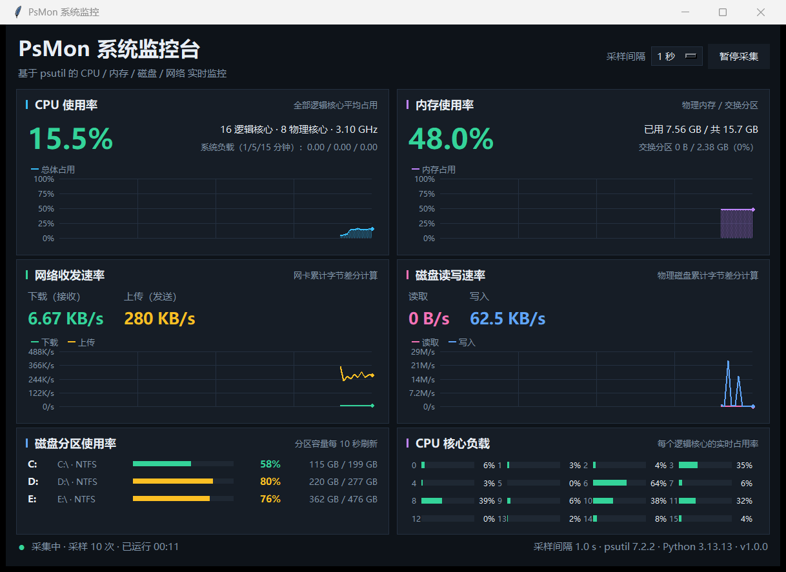
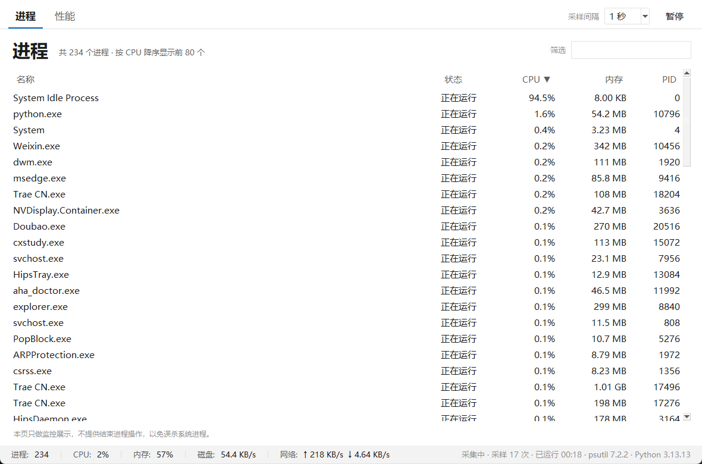

# PsMon 任务管理器

仿 Windows 任务管理器界面的系统监控程序，基于 Python + `psutil` + `tkinter` 实现，实时展示 CPU、内存、磁盘 IO、磁盘分区、网络收发速率，并提供与任务管理器一致的“进程 / 性能”两个页面。除 `psutil` 外不依赖任何第三方库，图表与进程列表样式均由自行绘制与 `ttk` 主题配置完成。





## 功能特性

- **性能页（仿任务管理器）**
  - 左侧组件列表：CPU、内存、磁盘、网络，含实时数值与迷你趋势图，选中项浅蓝底 + 左侧蓝条；
  - 右侧大图表：60 秒滚动窗口、浅灰网格、蓝色面积填充，磁盘/网络为读取 + 写入、接收 + 发送双曲线；
  - 右侧统计列：标签在上、数值在下的任务管理器式排版；
  - 底部详情：每个 CPU 的利用率小图（16 个逻辑核心）、内存组成条、磁盘分区使用率条、网络适配器状态列表。
- **进程页**
  - 名称 / 状态 / CPU / 内存 / PID 五列，状态显示为中文（正在运行、已挂起…）；
  - 点击表头排序（▼/▲），名称框实时筛选，PID 作为行标识增量刷新，不闪烁；
  - 进程 CPU 数值按逻辑核心数归一化，与任务管理器“占全部 CPU 的百分比”一致。
- **监控指标**：CPU 总体/分核心占用、主频、核心数、系统负载、运行时长；内存与交换分区；磁盘读取/写入速率；磁盘分区使用率；网络接收/发送速率与累计流量；网卡连接状态、IPv4、链路速率。
- **交互**：采样间隔 0.5 / 1 / 2 / 5 秒切换、暂停/继续采集、窗口尺寸自适应、关闭时安全停止后台线程。
- **工程化**：主采样线程、进程采样线程与界面线程解耦，异常隔离，8 个单元测试，Git 版本管理。

## 环境要求

- Python 3.9 及以上（开发验证使用 Python 3.13.13）
- Windows / Linux / macOS（`tkinter` 与 `psutil` 可用即可）
- 依赖：`psutil >= 5.9`

## 快速开始

```bash
# 1. 安装依赖
pip install -r requirements.txt

# 2. 启动程序
python main.py
```

Windows 下也可以直接双击 `run.bat` 启动。

Linux 若提示缺少 tkinter，请安装系统包，例如 `sudo apt install python3-tk`。

## 项目结构

```
.
├── main.py                    # 程序入口
├── psmon/
│   ├── __init__.py            # 版本信息
│   ├── collector.py           # 主采样线程、进程采样线程、速率计算
│   ├── format.py              # 容量/速率/时长/进程状态格式化
│   └── ui/
│       ├── app.py             # 主窗口、标签栏、ttk 样式、状态栏
│       ├── theme.py           # 任务管理器浅色配色与字体
│       ├── widgets.py         # 面积图、迷你趋势图、核心网格、进程表等控件
│       ├── performance.py     # “性能”页
│       └── processes.py       # “进程”页
├── tests/test_psmon.py        # 单元测试
├── docs/
│   ├── 系统说明文档.docx        # 系统文档 Word 版（提交用）
│   ├── 系统说明文档.md          # 系统文档 Markdown 版（仓库内便于预览）
│   └── images/
│       ├── main-window.png
│       └── processes.png
├── requirements.txt
├── run.bat
└── README.md
```

## 运行测试

```bash
python -m unittest discover -s tests -v
```

## 系统文档

完整的需求分析、AI 工具使用说明、技术框架、系统设计、实现功能与用户操作手册见
[docs/系统说明文档.md](docs/系统说明文档.md)，排版后的 Word 版见
[docs/系统说明文档.docx](docs/系统说明文档.docx)。

## 代码仓库

GitHub：`https://github.com/<你的账号>/psmon-system-monitor`

> 提交前请把 `<你的账号>` 替换为实际 GitHub 用户名，并同步更新 `docs/系统说明文档.md` 封面与第 8 章。

## 许可

本项目为课程实验作品，仅供学习使用。
